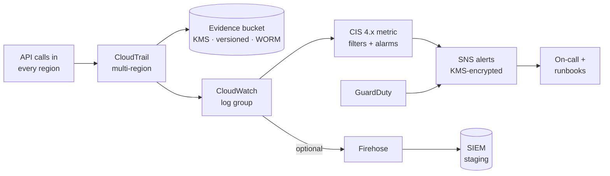

# Cloud Platform Control Plane

[](https://github.com/Ayush-cloud06/cloud-platform-control-plane/actions/workflows/ci.yml)


[](LICENSE)

A Terraform module that turns a bare AWS account into a **governed, audit-ready account**. It does this in one `apply`: identity, tamper-evident audit logging, CIS-benchmark detection and alerting, plus opt-in break-glass access, SIEM export, GuardDuty and cost guardrails.

Every control is **traced to a framework requirement and backed by an evidence command** an auditor can run, and every automated control is **asserted by a test in CI**. See the [compliance mapping](docs/compliance-mapping.md).

```hcl
module "control_plane" {
  source = "git::https://github.com/Ayush-cloud06/cloud-platform-control-plane.git?ref=v1.0.0"

  environment  = "prod"
  alert_emails = ["secops@example.com"]

  features = {
    break_glass      = true
    threat_detection = true
  }
}
```

---

## What you get

### Core baseline (always on)

| Capability | What it does | Framework |
| --- | --- | --- |
| **Role-only identity** | `admin` and `security-auditor` roles, both **MFA-gated** with bounded sessions. No IAM users. | CIS 1.7 · ISO A.5.15, A.8.2, A.8.5 |
| **Workload permission boundary** | Caps CI and workload roles. **Denies all IAM** (no privilege escalation) and denies disabling CloudTrail, GuardDuty, Config or the control plane's own alarms and evidence. | ISO A.8.2 · CSF PR.AA-05 |
| **GitHub OIDC for CI** *(opt-in)* | Short-lived credentials pinned to the repository and environment. **No access keys exist to leak.** Wildcard trust is rejected at plan time. | ISO A.5.17 |
| **Tamper-evident audit trail** | Multi-region CloudTrail with log file validation, SSE-KMS, versioning, access logging, lifecycle to Glacier IR, and optional **S3 Object Lock (WORM)**. | CIS 3.1, 3.2, 3.4, 3.5 · ISO A.8.15, A.5.28 |
| **Customer-managed encryption** | One rotating KMS key. The key policy is scoped per service with confused-deputy (`aws:SourceArn`) conditions. | CIS 3.5, 3.6 · ISO A.8.24 |
| **CIS monitoring alarms** | 15 metric filters with alarms: root use, IAM and CloudTrail changes, sign-in without MFA, KMS deletion, network changes, and more. | CIS 4.1–4.15 · ISO A.8.16 |
| **Central alerting** | One KMS-encrypted SNS topic; only this account's alarms and rules may publish. | ISO A.6.8 · CSF DE.AE-06 |
| **Account guardrails** | Account-wide S3 Block Public Access, EBS encryption by default, IAM Access Analyzer, strong password policy. | CIS 1.8, 1.9, 1.20, 2.1.4, 2.2.1 |

### Optional capabilities (feature flags)

| Flag | What it adds | Why it matters |
| --- | --- | --- |
| `break_glass` | Emergency admin role: named principals, **MFA in the last hour**, alarm on *every* API call made with it | Emergency access that cannot be used quietly ([runbook](docs/runbooks/break-glass.md)) |
| `threat_detection` | GuardDuty, with High and Critical findings routed to the alert topic | Managed detection of credential abuse, crypto-mining and malware |
| `siem_integration` | CloudTrail → subscription filter → Firehose (CMK) → dedicated staging bucket | Feeds Splunk, Datadog, Elastic or Sentinel without giving the SIEM access to audit evidence |
| `quota_monitoring` | Alarm when EC2 vCPU usage (incl. **GPU families**) passes X% of the live quota | Crypto-mining tripwire ([why not "enforcement"](docs/adr/0004-quota-monitoring-not-enforcement.md)) |
| `cost_controls` | Monthly budget (80% actual, 100% forecast) and daily cost anomaly detection | A spend spike is often the first visible sign of compromise |

## Architecture



Detection uses CloudTrail **metric filters rather than EventBridge rules**. IAM, STS sign-in and Organizations events reach EventBridge only in `us-east-1`, so an EventBridge rule anywhere else silently misses exactly the events that matter most ([ADR 0002](docs/adr/0002-metric-filters-over-eventbridge.md)).

More detail: [architecture](docs/architecture.md) · [threat model](docs/threat-model.md) · [design decisions](docs/adr/README.md)

## Quick start

**Prerequisites:** Terraform ≥ 1.5, AWS credentials for the target account, and the [root user hardened](docs/runbooks/root-account-hardening.md) (MFA on, no access keys).

```bash
cd examples/minimal
cp terraform.tfvars.example terraform.tfvars   # set alert_emails
terraform init
terraform plan
terraform apply
```

Then **confirm the SNS subscription email**. Alarms are not delivered until you do.

| Example | Deploys |
| --- | --- |
| [`examples/minimal`](examples/minimal) | Core baseline only, in a disposable sandbox (`force_destroy_buckets = true`) |
| [`examples/complete`](examples/complete) | Every capability, GitHub OIDC and 365-day Object Lock, configured as a production account would be |

**Approximate cost:** the core baseline costs a few USD per month in a quiet account. That is USD 1 for the KMS key, USD 1.50 for 15 alarms, and CloudWatch Logs ingestion for management events. The first copy of CloudTrail management events is free. GuardDuty and Firehose scale with volume.

## Quality gates

Every pull request runs:

| Gate | Tool | What it proves |
| --- | --- | --- |
| Format and validate | `terraform fmt` / `validate` | Module and both examples are syntactically valid |
| Lint | TFLint (`terraform` preset `all` + AWS ruleset) | Naming, typing, documentation, deprecated syntax, invalid AWS values |
| **Behavioural tests** | `terraform test` with a mocked AWS provider | **27 tests** assert the security properties (MFA conditions, boundary denies, encryption, TLS-only policies, OIDC pinning, input validation) **without AWS credentials** |
| IaC security scan | Checkov → SARIF in GitHub code scanning | 195 checks pass; each accepted risk is an inline `#checkov:skip` with a written justification |
| Secret scan | gitleaks | No credentials in history |

CI follows its own advice: actions are pinned to commit SHAs, the token is `contents: read` by default, and Dependabot keeps pins current.

```bash
make ci   # validate + lint + test + scan, locally
```

## Repository layout

```text
.
├── main.tf · variables.tf · outputs.tf · versions.tf   # root module: composition + feature flags
├── modules/
│   ├── kms/  logging/  alerting/  monitoring/  iam/  guardrails/   # core baseline
│   └── break_glass/  siem/  cost_controls/  quota_monitoring/  threat_detection/   # optional
├── examples/{minimal,complete}/   # runnable entry points (provider + backend live here)
├── tests/                         # terraform test suites + provider mocks
├── docs/
│   ├── compliance-mapping.md      # control → code → test → CIS/ISO/NIST/TISAX → evidence
│   ├── threat-model.md            # attacker goals, MITRE ATT&CK, residual risk
│   ├── architecture.md
│   ├── adr/                       # architecture decision records
│   └── runbooks/                  # alarm response, break-glass, root hardening
└── .github/workflows/ci.yml
```

## Limitations and roadmap

This is a **single-account** baseline. The honest boundary of what it covers is documented in the [gap analysis](docs/compliance-mapping.md#3-gap-analysis-what-this-baseline-does-not-cover). The next steps are:

- [ ] AWS Organizations: SCPs for preventive guardrails (region deny, leave-org deny)
- [ ] Organisation trail into a dedicated log archive account
- [ ] Org-wide AWS Config and Security Hub (CIS 3.3, 4.16) via delegated administrators
- [ ] Automated remediation for high-confidence detections (e.g. re-enable a stopped trail)
- [ ] Paging integration (PagerDuty or Opsgenie) alongside email

<!-- BEGIN_TF_DOCS -->
## Reference

<details>
<summary>Inputs, outputs and requirements (generated by terraform-docs)</summary>

## Requirements

| Name | Version |
|------|---------|
| terraform | >= 1.5.0 |
| aws | >= 6.0, < 7.0 |

## Inputs

| Name | Description | Type | Default | Required |
|------|-------------|------|---------|:--------:|
| alert\_emails | Email addresses that receive security alerts and cost notifications. Each must confirm the SNS subscription. | `list(string)` | n/a | yes |
| boundary\_allowed\_services | IAM service prefixes that workload automation may use. Identity, account and security-telemetry actions are always denied. | `list(string)` | <pre>[<br/>  "ec2",<br/>  "s3",<br/>  "rds",<br/>  "cloudwatch",<br/>  "logs",<br/>  "elasticloadbalancing",<br/>  "autoscaling"<br/>]</pre> | no |
| break\_glass\_trusted\_principal\_arns | Principals allowed to assume the break-glass role. Name specific principals in production. | `list(string)` | `[]` | no |
| cloudwatch\_log\_retention\_days | Retention of the CloudTrail CloudWatch log group (the searchable hot tier). | `number` | `365` | no |
| cost\_anomaly\_threshold\_usd | Minimum total impact in USD for a cost anomaly alert. | `number` | `10` | no |
| disabled\_security\_alarms | CIS monitoring alarms to skip, by key. See the monitoring module's available\_alarms output. | `list(string)` | `[]` | no |
| environment | Environment this account serves (e.g. security, dev, prod). Applied as a tag. | `string` | n/a | yes |
| existing\_anomaly\_monitor\_arn | Reuse an existing DIMENSIONAL/SERVICE cost anomaly monitor (AWS allows only one per account). | `string` | `null` | no |
| features | Feature flags for the optional capabilities. The core baseline is always deployed. Omitted flags default to false. | <pre>object({<br/>    break_glass      = optional(bool, false)<br/>    siem_integration = optional(bool, false)<br/>    cost_controls    = optional(bool, false)<br/>    quota_monitoring = optional(bool, false)<br/>    threat_detection = optional(bool, false)<br/>  })</pre> | `{}` | no |
| force\_destroy\_buckets | Allow Terraform to delete non-empty log buckets on destroy. Only for disposable sandbox accounts; never for accounts under audit. | `bool` | `false` | no |
| github\_oidc | GitHub Actions OIDC federation for the workload automation role. Set create\_provider = false if the account already has the GitHub OIDC provider. | <pre>object({<br/>    enabled         = optional(bool, false)<br/>    create_provider = optional(bool, true)<br/>    subjects        = optional(list(string), [])<br/>  })</pre> | `{}` | no |
| guardduty\_min\_severity | Minimum GuardDuty finding severity sent to the alert topic. | `number` | `7` | no |
| log\_archive\_after\_days | Days after which CloudTrail files move to S3 Glacier Instant Retrieval. Must be lower than log\_retention\_days. | `number` | `90` | no |
| log\_retention\_days | Days CloudTrail files are retained in S3. | `number` | `365` | no |
| metric\_namespace | CloudWatch namespace for control plane security metrics. | `string` | `"ControlPlane/Security"` | no |
| monthly\_budget\_limit\_usd | Monthly budget in USD. Alerts at 80% actual and 100% forecasted spend. | `number` | `50` | no |
| name\_prefix | Prefix for every resource name. Lets several control plane instances coexist and keeps bucket names within S3 limits. | `string` | `"cp"` | no |
| object\_lock\_mode | S3 Object Lock mode. GOVERNANCE can be bypassed by privileged principals; COMPLIANCE cannot be shortened or removed by anyone, including root. | `string` | `"GOVERNANCE"` | no |
| object\_lock\_retention\_days | S3 Object Lock (WORM) default retention for CloudTrail files. 0 disables it. Can only be turned on when the bucket is first created. | `number` | `0` | no |
| siem\_retention\_days | Days SIEM export objects are kept in the staging bucket. | `number` | `30` | no |
| tags | Additional tags applied to every taggable resource. | `map(string)` | `{}` | no |
| trusted\_principal\_arns | Principals allowed to assume the admin and security-auditor roles (MFA always required). Empty trusts IAM principals in this account. | `list(string)` | `[]` | no |
| vcpu\_quota\_threshold\_percent | Alarm when EC2 vCPU usage exceeds this percentage of the service quota. | `number` | `80` | no |

## Outputs

| Name | Description |
|------|-------------|
| admin\_role\_arn | MFA-protected admin role. |
| break\_glass\_role\_arn | Break-glass role (null when disabled). |
| cloudtrail\_arn | ARN of the multi-region CloudTrail trail. |
| cloudtrail\_bucket\_name | S3 bucket holding CloudTrail audit evidence. |
| cloudtrail\_log\_group\_name | CloudWatch log group receiving CloudTrail events. |
| enabled\_features | Resolved feature flags, including defaults. |
| guardduty\_detector\_id | GuardDuty detector ID (null when disabled). |
| kms\_key\_arn | KMS key protecting security telemetry. |
| security\_alarms | CIS monitoring alarms deployed, keyed by name, with the CIS recommendation each implements. |
| security\_alerts\_topic\_arn | SNS topic receiving every security alarm and finding. |
| security\_auditor\_role\_arn | MFA-protected security auditor role. |
| siem\_staging\_bucket\_name | Bucket the SIEM ingests from (null when disabled). |
| workload\_automation\_role\_arn | GitHub OIDC workload automation role (null when disabled). Use as role-to-assume in aws-actions/configure-aws-credentials. |
| workload\_boundary\_policy\_arn | Permission boundary to attach to workload roles. |

</details>
<!-- END_TF_DOCS -->

## License

Apache 2.0. See [LICENSE](LICENSE).
