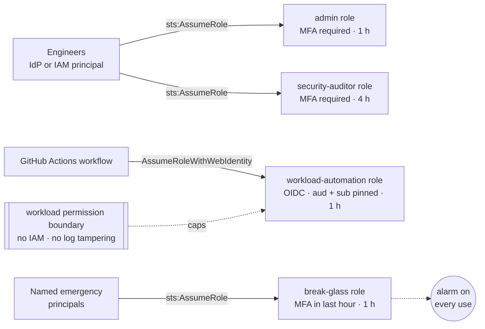
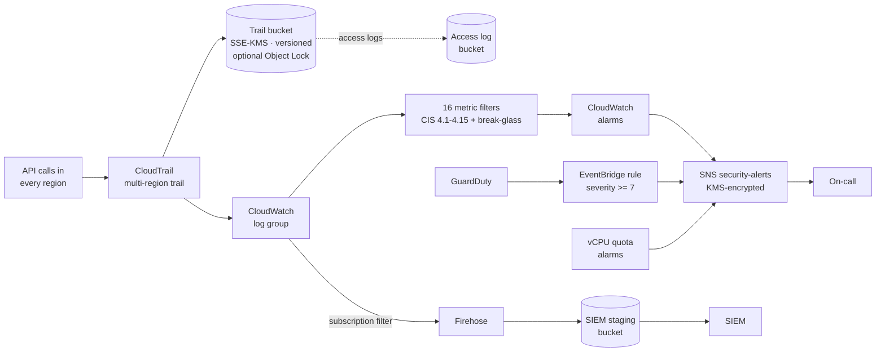
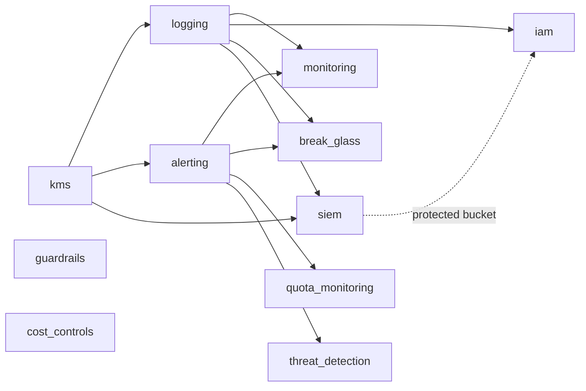

# Architecture

## Layers

The control plane has two layers:

- **Core baseline (always on):** `kms`, `logging`, `alerting`, `monitoring`, `iam`, `guardrails`. An account without these is not a governed account, so they cannot be switched off.
- **Optional capabilities (feature flags):** `break_glass`, `siem`, `cost_controls`, `quota_monitoring`, `threat_detection`.

### Access paths (identity)

### Telemetry, detection and alerting

All data at rest in this flow (trail files, log group, topic, Firehose, SIEM bucket) is encrypted with one customer-managed KMS key that rotates every year ([ADR 0005](adr/0005-single-cmk-for-security-telemetry.md)). Budgets and Cost Anomaly Detection email the same recipients directly.

## Event flow for a single detection

Example: someone runs `aws iam attach-role-policy` from any region.

1. IAM is a global service. CloudTrail records the call and, because `include_global_service_events = true`, the multi-region trail delivers it.
2. The event is written (a) as an encrypted, digest-validated file in the trail bucket and (b) to the CloudWatch log group.
3. The `iam-policy-changes` metric filter matches and emits `1` to `ControlPlane/Security`.
4. The alarm evaluates a 5-minute `Sum ≥ 1` and moves to `ALARM`.
5. CloudWatch publishes to the KMS-encrypted SNS topic. The topic policy admits it because `aws:SourceArn` is an alarm in this account and region.
6. On-call receives the email and follows [security-alarm-response.md](runbooks/security-alarm-response.md).
7. If SIEM export is enabled, the same event also reaches the SIEM staging bucket through Firehose for correlation.

## Module dependency graph

## Naming

Every resource name starts with `name_prefix` (default `cp`). Bucket names add account ID and region (`<prefix>-cloudtrail-<account>-<region>`) so they are globally unique and predictable. That is why `name_prefix` is limited to 20 characters: the longest bucket name must fit the 63-character S3 limit.

## Design decisions

The reasoning behind the non-obvious choices is in [ADRs](adr/README.md).
